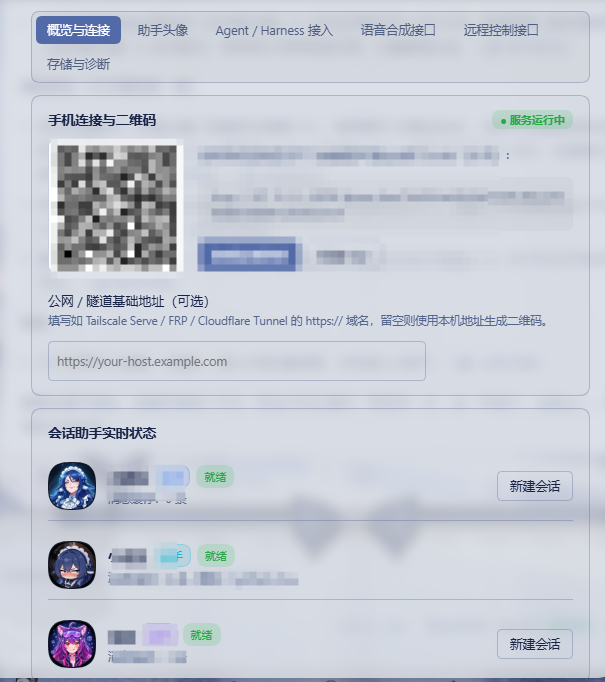
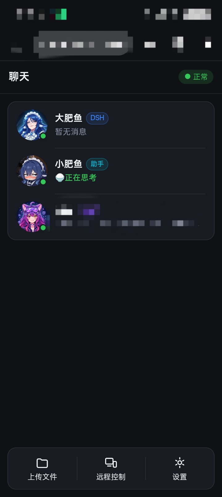
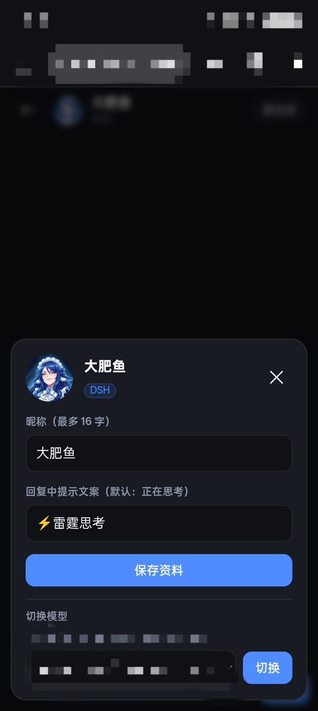

# dsh-phone-chat

[](https://github.com/Hyrrokin141/Dsh-phone-chat/actions/workflows/ci.yml)
[](./LICENSE)

简体中文 | [English](./README.en.md)

一个给 **DeepSeek Harness (DSH)** 用的轻量手机远程聊天插件。  
装好以后，你可以直接在手机浏览器里**像聊微信一样跟电脑上的 DSH 助手聊天、发图片、切模型**，还可以按需开启语音回复和远程控制——**不用装手机 App，扫个二维码就能连上。**

## 界面预览

### 电脑端：DSH 设置面板（`远程聊天`）

<p align="center">
  
</p>

### 手机端：聊天列表 / 改资料与切模型

<table>
  <tr>
    <td align="center">
      <br />
      <sub>打开手机就能看所有助手的在线状态、聊天、传文件</sub>
    </td>
    <td align="center">
      <br />
      <sub>在手机上直接改昵称、改“正在思考”提示词、切换模型</sub>
    </td>
  </tr>
</table>

> 说明：本仓库不包含任何个人头像（刚装好时默认是纯黑头像 `#000000`），上面截图里的头像和昵称都是用户在自己电脑上自定义的展示效果。

## 它能做什么？

- **全在 DSH 面板里点点鼠标就能配**：装好后，DSH 设置里会多出一个 **`远程聊天`** 菜单，里面分成 6 个标签页：
  1. **概览与连接** — 生成手机连接链接和二维码、填外网隧道地址、看各个助手当前是否在线。
  2. **助手头像** — 给每个助手换头像、改名字、挑徽章颜色、改“正在思考”的提示文案。
  3. **Agent / Harness 接入** — 用来把其他外部 AI 助手也接进手机聊天列表。
  4. **语音合成接口（TTS）** — 想听语音回复的话，把你自己的语音接口填在这里。
  5. **远程控制接口** — 给手机端加几个自己定好的快捷按钮，远程触发电脑上的操作。
  6. **存储与诊断** — 看文件存哪儿了、调图片空间上限、排查连接状态。
- **支持同时和多个助手聊天**：
  - 默认接通你的主 DSH 助手；
  - 支持和开源插件 [dsh-fish](https://github.com/mochi-fish/dsh-fish) 联动（默认关闭；如果你装了它，打开开关就会自动连上）；
  - 还能再挂一个外部助手（命令行工具或本地文件队列），本插件只负责帮你传话，不干涉外部工具自己的模型设置。
- **语音和远程控制都是“你要用才开”，默认安全关闭**：
  - **语音（TTS）**：插件里不自带任何第三方或收费语音服务，你自己有本地命令行或 HTTP 语音接口，按说明填进去就能用。
  - **远程控制**：默认关着，**绝对不会**给手机开放随便敲系统命令的危险权限；只有你自己明确写进白名单的动作（或带签名的本地 Webhook）才能点。
- **个人数据和代码彻底分开**：你的头像、密钥、设置和聊天记录全存在自己电脑的 `~/.dsh/phone-chat/` 文件夹里，不跟插件代码混在一起，升级代码不会丢配置，也不会误传隐私。

## 怎么安装和使用？

> **懒人用法**：如果你正在用 AI Agent，直接把这个仓库链接发给它，说一句「帮我把这个插件装到 DSH 里」，它照着 `cordis.patch.example.yml` 就能帮你配好。

### 手动安装步骤

**前提条件**：电脑已安装 **Node.js 20+**（已在 Node.js 22 测试通过）和 **DSH**（`>= 0.2.0-rc.1 < 0.3.0-0`）。

1. **把插件下载到你的 DSH 插件目录**
   ```bash
   git clone https://github.com/Hyrrokin141/Dsh-phone-chat.git
   ```
2. **启用插件**
   打开你 DSH 配置目录下的 `cordis.patch.yml`，把 [`cordis.patch.example.yml`](./cordis.patch.example.yml) 里的内容粘进去：
   ```yaml
   - insert:
       - id: phone-chat
         name: dsh-phone-chat
         config:
           hostOnly: true
   ```
3. **重启 DSH，打开设置面板**
   重启后进入 DSH 的 **设置 → `远程聊天`**，看到右上角显示「服务运行中」就说明装好了。
4. **手机扫码开聊**
   在 **概览与连接** 页面直接用手机扫二维码（或者复制带 `?k=...` 的链接在手机浏览器打开）。
5. **出门在外也想连？（可选）**
   用 Tailscale Serve、FRP 或 Cloudflare Tunnel 等内网穿透工具，把 DSH 的本地端口映射出一个 `https://` 地址，填进面板的 **公网 / 隧道基础地址**，二维码就会自动变成外网可用的链接。

## 配置和文件存在哪儿？

插件启动时会按下面顺序读取设置，后面的会覆盖前面的：

```text
内置默认设置  ←  cordis.patch.yml 里的配置  ←  你在 DSH 面板里保存的 ~/.dsh/phone-chat/config.json
```

- 像语音鉴权头（`tts.authHeader`）、Webhook 密钥（`remoteControl.webhookSecret`）这类敏感信息都是**只存不回显**的，网页上看不到明文。
- 聊天相关文件默认存在 `~/.dsh/phone-chat/data/` 下：
  - `workspace/` — 主 DSH 会话的工作目录
  - `chat/` — 外部助手队列传话目录
  - `photos/` — 手机发给电脑的图片（默认上限 512 MiB，可在面板调整）
  - `files/` — 上传的共享文件
  - `history/` — 聊天记录

## 代码目录一览

```text
.
├── cordis.patch.example.yml   # DSH 启用插件的配置示例
├── docs/images/               # 文档展示截图
├── lib/
│   ├── index.js               # 插件主入口与接口路由
│   ├── client.js              # DSH 设置面板页面（无需打包编译）
│   ├── page.html              # 手机端聊天与远程控制页面
│   ├── config.mjs             # 配置读写与敏感信息脱敏
│   ├── harness.mjs            # 外部 CLI / 文件队列助手适配
│   ├── tts.mjs                # CLI / HTTP 语音合成接口实现
│   ├── remote-control.mjs     # 白名单远程控制与签名 Webhook
│   └── qr.mjs                 # 零依赖二维码生成
├── tests/
│   └── test-open-plugin.mjs   # 自动化功能测试
└── tools/
    └── check-privacy.mjs      # 发布前隐私与文件编码检查
```

## 开发者自检

改完代码后，跑一下这两条命令确认功能和隐私都没问题：

```bash
npm test
npm run check:privacy
```

## 致谢

- [mochi-fish/dsh-fish](https://github.com/mochi-fish/dsh-fish)（作者：[@mochi-fish](https://github.com/mochi-fish)）— 本插件支持可选联动的开源伙伴插件。
- **DeepSeek Harness (DSH)** — 插件运行平台。

## 开源协议

[MIT](./LICENSE) © 2026 Hyrrokin
